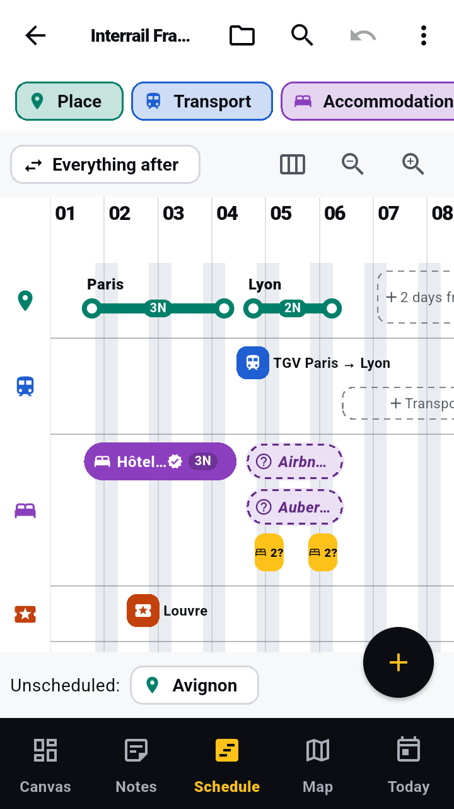
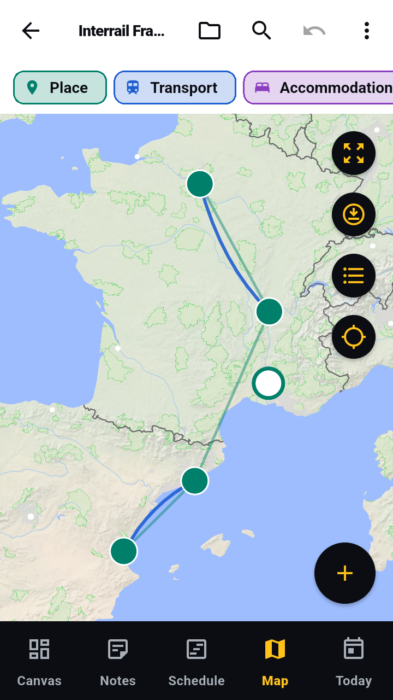
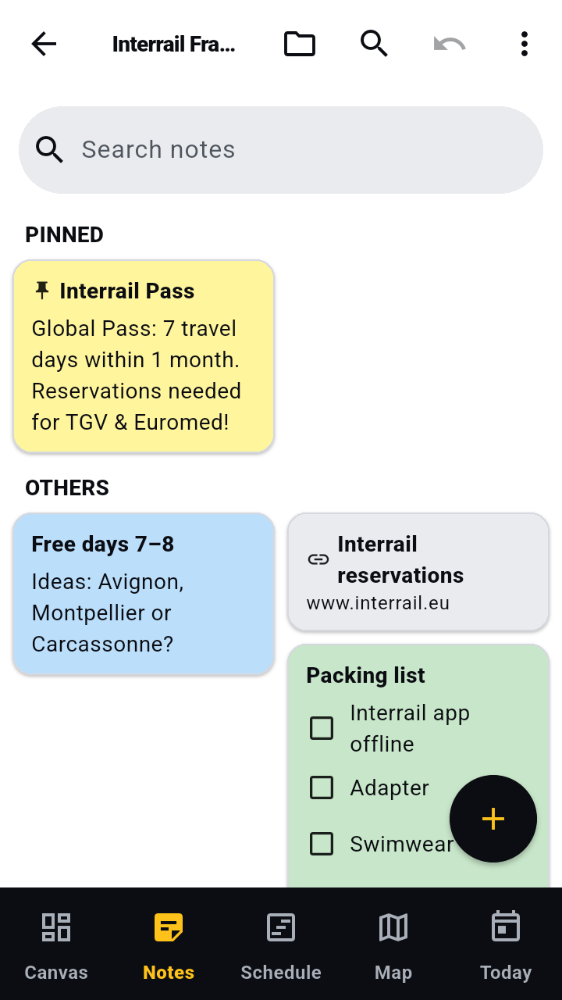
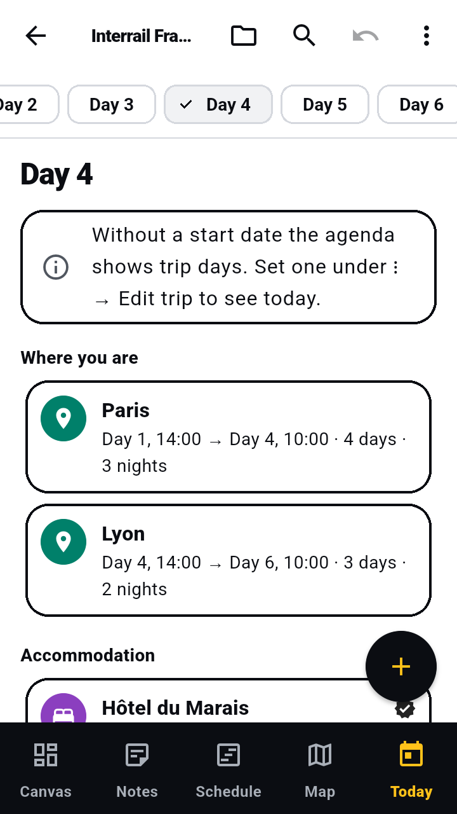

# Tripboard – Travel Planner

Tripboard plans a trip in four views of the same data — a free canvas, a notes board, a
day-by-day schedule and a map — plus a *Today* agenda for when you are on the road. It is an
Android-first Flutter app (iOS-ready) that works **offline-first** and needs **no account**:
every trip, note and file lives in a local database on the device. In English and German.

<p>
  
  
  
  
</p>

## Install

Two ways, both free:

1. **Download from GitHub** — take the `arm64-v8a` APK from the
   [latest release](https://github.com/LeoStumpf/travelPlanner/releases/latest) (it fits nearly
   every phone; `armeabi-v7a` is for older 32-bit ones), open it and allow the install. To get
   updates automatically, add this repository to [Obtainium](https://obtainium.imranr.dev/).
2. **Install through Google Play as a tester** — *coming soon.* A closed test on Google Play is
   being set up; this section will link to it once it is open.

The two are signed differently, so Android will not update one with the other: to switch,
**back up your trips first** (trip list → ⋮ → *Export all trips*, which saves a ZIP), uninstall,
install the other and restore (⋮ → *Import backup*).

> **Transparency:** Tripboard was "vibe-coded" collaboratively with Claude (Anthropic's AI
> assistant), which wrote much of the code under human direction.

## Features

A trip is built from four kinds of items — *Place*, *Transport*, *Accommodation* and
*Activity* — each with a status (*Idea*, *Option*, *Planned*, *Booked*) and an optional
*Fixed* flag. Notes, checklists, links, images and tickets are collected alongside them.

### Canvas & Notes

- **Canvas**: a free surface for items and notes. Swipe to pan; long-press and drag to move an
  element, pinch to zoom.
- **Notes**: a Keep-style grid for notes, checklists, links, images and tickets.
- Link notes fetch a preview (title and image) of the page.

### Schedule (timeline)

- Four layers: places → transport → accommodation (in nights) → activities.
- **Move** a block by long-pressing and dragging; change start/end with the handles of the
  selected block. Following items move along, *Fixed* items stay put.
- **Rotate** with the button next to the zoom buttons (*Show vertically* / *Show
  horizontally*): days then run downwards and the layers stand side by side as columns,
  filling the screen width; dragging, handles and zoom work up/down. The app remembers the
  choice.
- **Zoom**: zooming in adds times to the day header (every 12, 6, 3, 2 hours or hourly,
  depending on space) and thin hour lines; fully zoomed in, one hour is 80 dp long.
- Narrow blocks show their title beside them when there is room; the number of nights sits on
  the place's line; rows grow with the system font size.
- An empty trip shows *Add first place*.
- Items under *Unscheduled* get a day via *Schedule on …* (suggested: free days for places, the
  place's first full day for activities), with sensible default times per kind.
- **Missing transport**: between two consecutive places without a connection, the transport
  layer shows "+ Transport"; a tap opens the editor with both places and a matching
  departure. A place's detail sheet offers *Transport here* and *Onward transport*.
- **Ticket details** on transports (optional): departure/arrival station or airport,
  *Train / flight no.*, seat/platform, *Booking reference*. The detail sheet and *Today* show
  them like a boarding pass; a tap copies the booking reference.

#### Conflicts

- Shown in the schedule together with free days and nights without accommodation.
- A conflict is: overlapping places; accommodation or activities outside their place; gaps at
  transports; two fixed (planned/booked) accommodations on the same night; an activity during
  a transport; two transports at the same time.
- The count appears in the trip's app bar (tap for a list) and on the trip's card in the trip
  list.
- Every conflict offers a one-tap fix (e.g. *Move after "TGV"*, *Make "…" an option*) or
  explains why there is none (fixed item, both booked), and links via chips to both items
  involved.
- Setting an accommodation to planned/booked by hand turns competing planned ones back into
  options.
- If a night already has accommodation options, its marker shows how many and offers them
  first; each option can also be chosen (*Choose this option*) or marked booked in its own
  detail sheet.

### Map

- MapLibre with an OpenStreetMap style from OpenFreeMap — no API key needed.
- Long-press the map to add something there.
- Tap a circle, a label or just next to it to open the detail sheet; the map keeps its zoom and
  only pans if the item is outside the view.
- Accommodation and activities without their own coordinates sit in a ring around their place
  instead of hiding beneath it.
- *My location* asks for the location permission, shows a blue dot and follows it while the map
  is visible.
- *Navigation* in the detail sheet hands the place (for transports: the departure station or
  place) to a maps app via a `geo:` link, or else to Google Maps in the browser.
- *Save map offline* downloads the trip's area (an overview plus street level around every
  place) for the road. With no network and no saved map, the app says so and lists the trip's
  places instead.

### Today

The agenda for the road:

- A strip with every trip day on top (*Today*, *Tomorrow*, *Yesterday*, otherwise the date).
- Below it the chosen day: where you are; the accommodation with address and check-in/out (or
  a note that a bed is still missing for the night, with the options); the next transport with
  departure and arrival; the day's programme.
- Attachments of an item and of its linked notes (tickets) open with a tap.
- *Jump to today* returns from any other day.
- A trip that is running right now (start date set, today within the trip) opens straight
  into this view.
- Everything comes from local data, so it works offline. Logic: `lib/domain/agenda.dart`.

### Files

- Every trip has its own file area (folder icon in the trip's app bar, *Files & tickets*) for
  tickets, bookings, photos and other documents, with nested folders.
- *Add* takes several files at once (*Choose files* or *Photos from gallery*), a camera photo,
  or a whole folder with subfolders (*Import folder*). Android does not release every file in
  every folder; the app reports what it could not read, and multi-select helps then.
- Open, rename, move, share and delete (with undo) — several at once after a long-press.
- One file can be linked to any number of items and notes (e.g. one PDF for both flights); the
  chips under the file lead to them.
- In an item's editor, new attachments go to the top of the file area and are linked right
  away; *From the trip's files* links existing ones. *Unlink* and deleting an item keep the
  file in the file area.
- The detail sheet and *Today* show linked files (including those of linked notes); search
  also finds unlinked files by name and folder.
- Files live in private app storage and are part of the backups. Any file can be shared to
  Tripboard from other apps.
- Logic: `lib/domain/workspace.dart`; page: `lib/ui/files/`.

### Checklists & packing lists

- Tick checklist entries right in the notes grid (tap the entry, with undo); ticked ones fold
  into "+ n done".
- *+ → Packing list* builds a checklist from the templates *Basics*, *Beach*, *Hiking* and
  *City* (combinable, duplicates only once, texts in the app language), or copies a checklist
  from another trip (without ticks).
- In the editor, *⋮ → Add from template or trip …* adds missing entries to an existing list.
- Open entries can be reordered by their handle (screen readers: *Move up* / *Move down*).
- Logic: `lib/domain/packing.dart`.

### Search

- The magnifier in the trip list searches all trips (not the trash); inside a trip it searches
  that trip first, and *All trips* widens it.
- Searches titles, places, notes, links, ticket details (stations, train/flight number, seat,
  booking reference) and attachment names of items, plus title, text, link and checklist
  entries of notes.
- Case and accents don't matter ("cafe" finds "Café"); every word must occur, not necessarily
  in the same field.
- Results are grouped by trip, with the field they were found in and the term highlighted. A
  tap opens the trip and the detail sheet or note editor; a tap on the trip name opens the
  trip.
- The notes grid search uses the same logic and says *No results for "…"* when nothing
  matches.
- Logic: `lib/domain/search.dart`.

### Time zones (optional)

- Each place can get an IANA time zone (e.g. `Asia/Colombo`), the trip a home zone (*Edit
  trip*) for everything without its own.
- All times stay local times: accommodation and activities use their place's zone; a
  transport departs in the zone of its origin and arrives in the zone of its destination
  (overridable per transport in the editor).
- For comparisons the app converts to absolute time, so flight durations (FRA 21:30 → CMB 10:30
  = 8 h 30 min), order and conflicts are right — even when a flight across the date line
  "lands before it departs". Daylight saving time follows from the start date.
- Detail sheet, editor and *Today* show UTC offsets and the real duration for transports that
  cross zones.
- Without zones everything behaves as before. The zone data ships with the `timezone` package,
  no network needed. Logic: `lib/domain/zones.dart`.

### Place search

- The editor searches places online via Photon (OpenStreetMap).
- Offline it is no dead end: it shows *Recently used* places from all trips (not the trash,
  filtered as you type) and recognises pasted Google Maps, OpenStreetMap, Apple Maps and
  `geo:` links as well as coordinates (`48.8584, 2.2945`, `48°51'30"N 2°17'40"E`,
  `N 48.85 E 2.29`).
- A place can also be saved by name only (*Save "…" without coordinates*); it is then missing
  from the map.
- Short links (`maps.app.goo.gl/…`) are resolved online. When nothing is found, it says so.
- Logic: `lib/domain/places.dart`.

### Costs & budget

- Every item can have a cost: amount, currency (ISO code like `EUR`, `LKR`; empty = home
  currency), per person or total, paid or not.
- *Edit trip* sets the *Home currency* and the number of travellers; per-person prices count
  once per traveller.
- *⋮ → Budget* shows the total in the home currency with paid/open, per person and *By layer*;
  options and ideas are listed separately and not counted.
- Exchange rates are entered by you ("1 EUR = 330 LKR") and stored with the trip, so the budget
  works offline; if a rate is missing, the page says which amount is left out.
- A tick in the item list or *Paid* in the detail sheet marks something as paid, all with undo.
- Logic: `lib/domain/budget.dart`.

### Sharing with fellow travellers

- *⋮ → Share…* passes the plan on through the system share menu as:
  - *Itinerary as text* — day by day, for messengers and email (*Copy text* puts it on the
    clipboard);
  - *Itinerary as PDF* — A4, fonts in `assets/fonts`;
  - *Calendar (ICS)*.
- Only planned or booked items with a date are shared; options and ideas stay private.
- Text and PDF show the route with nights and, per day, the places; transports with times,
  stations, train/flight number, seat and booking reference; check-in/out and the night's
  stay; missing beds; activities with their notes and linked notes; and finally the remaining
  notes and checklists. Without a start date they show "Day 1, Day 2 …".
- The calendar file needs real dates: without a start date the app asks for one and saves it
  in the trip (with undo). Places become all-day events; times with a known zone go in as UTC,
  others as "floating" local time. Each event has a stable UID, so re-importing updates it.
- Logic: `lib/domain/itinerary.dart` and `lib/domain/ics.dart`; texts and PDF in
  `lib/ui/share/`.

### Reminders

- *⋮ → Reminders* (also reachable from *Edit trip*) turns on local notifications before
  departures (transports), check-in and check-out (accommodation) for one trip.
- Pick one or more lead times (15 min to 2 days, default 2 h) and what to be reminded of; the
  sheet lists the *Next reminders*.
- Only planned and booked items with a date, and only if the trip has a start date (otherwise
  the sheet offers to set it).
- Times with a zone are scheduled as real instants, times without one as phone clock time.
- Every change to the plan or the settings reschedules all reminders (at most the next 60), as
  does returning to the app. Tapping a reminder opens the trip at the item.
- On Android 13+ the app asks for the notification permission when you switch reminders on
  (after a refusal, *Allow* leads to the settings). Exact times on Android 12+ need the *Alarms
  & reminders* permission; without it reminders may come a few minutes late, and the sheet
  offers *Allow exact times*. After a reboot the plugin reschedules them itself.
- The settings are stored per device in shared preferences, not in the trip, so a shared or
  imported trip doesn't ring on a fellow traveller's phone.
- Logic: `lib/domain/reminders.dart`; scheduling: `lib/data/reminder_scheduler.dart`
  (flutter_local_notifications).

### Plan with Claude

- *⋮ → Plan with Claude …* (in the trip list or a trip) copies a guide to the `tripboard-plan`
  exchange format, optionally with the current plan (*Copy trip for Claude* / *Copy guide
  only*). Paste it into the Claude app and let Claude plan with web search.
- Claude's answer ends in a JSON block. Copy it and use *Apply plan from clipboard*, or share
  the answer straight to Tripboard. Returning to the app with a plan on the clipboard brings
  up a snackbar, *Plan found in the clipboard. Apply plan?* (each plan is offered once).
- Before applying, a preview lists new, changed (with the changed fields) and deleted entries
  (in red) by title, plus how many conflicts the trip would have afterwards.
- Missing coordinates are looked up via OpenStreetMap (Photon), preferring the surroundings of
  the related place or the trip's centre and countries the trip already visits; what isn't
  found is listed afterwards ("x of y not found").
- An import into an existing trip can be undone as one step.
- The format is described in [`assets/plan_format.md`](assets/plan_format.md), the logic is in
  `lib/domain/plan_exchange.dart`. Known `ref`s update existing entries, unknown ones create
  new ones; only what is listed under `remove` gets deleted. Time zones are optional
  (`trip.tz` as home zone, `tz` on places, `tz`/`endTz` on transports; times are always
  local). Costs likewise: `cost` on items (`amount`, `currency`, `perPerson`, `paid`) plus
  `trip.currency`, `trip.travellers` and `trip.rates`; the guide asks Claude to fill in
  estimated prices.

### Everyday details

- An item's detail sheet has quick actions: booked on/off, fixed on/off, *−1 day* / *+1 day*
  (in the current move mode) and delete — all with undo.
- Each view explains its hidden gestures once in a tip banner; dismissals are stored in shared
  preferences, and *⋮ → Show tips again* resets them.
- Content shared to Tripboard from other apps (links, text, screenshots, tickets) lands as a
  note in a trip.
- *Load example trips* adds two demo trips (Interrail France/Spain and Sri Lanka).

### Data, backups & trash

- All data is local (SQLite via drift).
- Export a single trip (*Export as backup*) or all trips at once (*Export all trips*) as a ZIP;
  *Import backup* accepts both.
- **Auto-backup**: on start and when going to the background, the app writes a backup of all
  trips if the last one is older than 24 hours. These live in the app folder on external
  storage (`Android/data/<app>/files/backups`); the last 7 are kept. *⋮ → Backups & restore*
  shows the last backup and restores one.
- Android cloud backup covers the database and attachments (`android/app/src/main/res/xml/`).
- Deleted trips stay in the *Trash* (⋮ → *Trash*) for 30 days and are removed for good, with
  their attachments, at the next app start after that.

### Accessibility

- Schedule blocks, canvas nodes and map markers have one-sentence screen-reader labels
  ("Kandy, Place, 3 nights, …, Option, Fixed, Conflict").
- Instead of long-press dragging, blocks and nodes offer the actions *1 day earlier* / *1 day
  later* (like −1/+1 day in the detail sheet, with undo; not for fixed items).
- Missing nights, "+ Transport", free days and day headers (long-press: add something here) are
  labelled.
- The native map is announced as a whole ("Map with 9 places"); the *Places as a list* button
  shows the same content as a list.
- Options and ideas differ by more than paleness: dashed border or dashed line plus a status
  icon; on the map, hollow rings.
- Colour pickers (notes, trips) and the day arrows in the editor have 48 dp touch targets; text
  on the layer colours and option tints reaches at least 4.5:1 contrast.
- Helpers: `lib/ui/common/a11y.dart`; checked in `test/ui/a11y_test.dart`.

### Languages

- English and German. The app follows the device language (on Android 13+ also the per-app
  language set in the system settings); any other language falls back to English.

## Tech stack

| Concern | Package |
|---|---|
| Framework | Flutter (Android-first, iOS-ready) |
| Local DB | [`drift`](https://pub.dev/packages/drift) + `drift_flutter` (SQLite) |
| State | [`flutter_riverpod`](https://pub.dev/packages/flutter_riverpod) |
| Map | [`maplibre_gl`](https://pub.dev/packages/maplibre_gl) with OpenFreeMap tiles |
| Location | [`geolocator`](https://pub.dev/packages/geolocator) (only for *My location*) |
| Network | [`http`](https://pub.dev/packages/http) — Photon place search, link previews, short-link resolving |
| Time zones | [`timezone`](https://pub.dev/packages/timezone) (bundled data) |
| Reminders | [`flutter_local_notifications`](https://pub.dev/packages/flutter_local_notifications) |
| Sharing & PDF | [`share_plus`](https://pub.dev/packages/share_plus), [`pdf`](https://pub.dev/packages/pdf), [`receive_sharing_intent`](https://pub.dev/packages/receive_sharing_intent) |
| Files | [`file_picker`](https://pub.dev/packages/file_picker), [`image_picker`](https://pub.dev/packages/image_picker), [`open_filex`](https://pub.dev/packages/open_filex), [`archive`](https://pub.dev/packages/archive), [`path_provider`](https://pub.dev/packages/path_provider) |
| UI | [`flutter_staggered_grid_view`](https://pub.dev/packages/flutter_staggered_grid_view), [`intl`](https://pub.dev/packages/intl), `flutter_localizations` |
| Icons | `flutter_launcher_icons` (dev) |

## Project layout

| Path | Contents |
| --- | --- |
| `lib/domain/` | Models, time model, `zones.dart` (time zones), `scheduler.dart` (move logic), `analysis.dart` (conflicts, gaps), `agenda.dart` (Today), `budget.dart`, `packing.dart`, `search.dart`, `places.dart`, `itinerary.dart`/`ics.dart` (sharing), `reminders.dart`, `workspace.dart` (file folders), `plan_exchange.dart` (Claude format). Pure Dart. |
| `lib/data/` | drift database and migrations, repository, attachments, place search (Photon), link preview, offline maps, location, backup/auto-backup, sharing, reminders (`reminder_scheduler.dart`) |
| `lib/state/` | Riverpod providers, shared UI state, undo |
| `lib/ui/` | Trip list, trip shell, schedule, map, canvas, notes, Today, files, budget, search, sharing, reminders, backups, Claude exchange, editors |
| `lib/l10n/` | English and German texts (ARB) and the classes generated from them |

## Develop

```bash
flutter pub get
dart run build_runner build   # after changes to lib/data/db.dart
flutter test
flutter run
```

### Database migrations

- When the schema in `lib/data/db.dart` changes: raise `schemaVersion`, add a `fromXToY` step
  and run `dart run drift_dev make-migrations`. That stores a schema snapshot in
  `drift_schemas/` and regenerates `lib/data/db.steps.dart` and the test helpers in
  `test/drift/`.
- When the models' JSON layout changes so that old data would be read wrongly: raise
  `currentDocVersion` in `lib/data/doc_migrations.dart` and add a step. Stored rows are then
  rewritten when opened, backups when imported.

### Translations

- All texts live in `lib/l10n/app_en.arb` (template) and `lib/l10n/app_de.arb`. Every new text
  goes into both; `flutter gen-l10n` (or `flutter pub get` / `flutter run`) then generates the
  classes in `lib/l10n/`.
- In code, texts come from `context.l10n` (`lib/ui/common/l10n.dart`). That is also where the
  language-neutral values from `lib/domain` are put into words: kinds, statuses, transport
  modes, conflicts (`Conflict` carries type and values), import notes (`PlanWarning`), days
  and dates (via `intl` in the current language) and the example trips' texts (`DemoTexts`).
  This keeps `lib/domain` free of Flutter and of German text.
- `test/ui/l10n_test.dart` checks that both ARB files have the same keys and placeholders and
  that no German literals remain in `lib/ui`, `lib/domain` and `lib/state`.

### Release builds & signing

```bash
flutter build apk --release --split-per-abi --target-platform android-arm64   # APK for current phones (~39 MB)
flutter build appbundle --release                                             # for the Play Store
```

- Release builds are signed with the upload key from `android/key.properties`. That file is
  not in the repo; the keystore is `~/tripboard-upload-keystore.jks`. Without the file, the
  build falls back to the debug key.
- The release build runs Android lint (`lintVitalRelease`): the backup rules (`res/xml/`) may
  only exclude what lies inside an included path.

### Icon & store graphics

- The app icon comes from `assets/icon/*.svg`: render to PNG, then run
  `dart run flutter_launcher_icons`.
- Play Store graphics are in `store/play/`; the feature banner is rendered from
  `store/feature-graphic.html` (the command is in the file).
- Store texts are in `fastlane/metadata/android/en-US/`.

### Releasing

1. Raise `version:` in `pubspec.yaml` (`<name>+<versionCode>`; the code only ever goes up).
2. Write `fastlane/metadata/android/en-US/changelogs/<versionCode>.txt` (≤ 500 characters;
   it is also Play's "What's new").
3. Commit, push, then `git tag v<name> && git push origin v<name>`.
4. CI (`.github/workflows/ci.yml`) checks that the tag matches the version, builds and signs
   the split APKs and the AAB, and publishes a GitHub release with
   `Tripboard-<name>-<abi>.apk`.
5. The AAB for Google Play comes from the run's artifact.

CI needs the repository secrets `ANDROID_KEYSTORE_BASE64`, `ANDROID_KEYSTORE_PASSWORD` and
`ANDROID_KEY_PASSWORD`.

## Privacy

No account, no analytics, no ads, no crash reporting. Your trips, notes and files stay in the
app's private storage on the device — and in the backups you make or Android's own device
backup. The app only goes online for what you use: map tiles from OpenFreeMap (and *Save map
offline*), place search and coordinate lookup via Photon (komoot), resolving short map links,
and link previews of web pages you add to a note. *Navigation* may open Google Maps in the
browser if no maps app is installed. Location is used only while *My location* is on and the
map is visible. Full detail in [`PRIVACY.md`](PRIVACY.md).

## License

Tripboard is free software, released under the **GNU Affero General Public License, version 3
or (at your option) any later version** — see [`LICENSE`](LICENSE) for the full text.

    Tripboard – Travel Planner
    Copyright (C) 2026 Leo Stumpf

    This program is free software: you can redistribute it and/or modify it under the terms
    of the GNU Affero General Public License as published by the Free Software Foundation,
    either version 3 of the License, or (at your option) any later version.

    This program is distributed in the hope that it will be useful, but WITHOUT ANY WARRANTY;
    without even the implied warranty of MERCHANTABILITY or FITNESS FOR A PARTICULAR PURPOSE.
    See the GNU Affero General Public License for more details.

    You should have received a copy of the GNU Affero General Public License along with this
    program.  If not, see <https://www.gnu.org/licenses/>.

The open-source packages Tripboard builds on keep their own licences — see
[`THIRD_PARTY_NOTICES.md`](THIRD_PARTY_NOTICES.md). Map data © OpenStreetMap contributors;
map tiles by OpenFreeMap.
